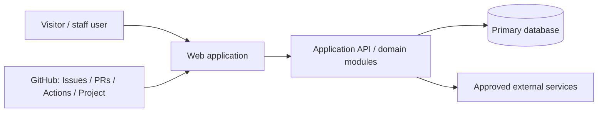

# Architecture

## Current recommendation

Start with a **modular monolith** and one deployable web application unless a verified requirement requires independent scaling, deployment, or ownership. This lowers coordination and operations cost; reassess at a clear boundary, not by default.

## Context

## Modules and ownership

| Module | Responsibility | Public contract | Owner role |
|---|---|---|---|
| Web UI | pages, accessibility, client behaviour | UI states / API client | frontend |
| Application | use cases, authorization, validation | API | backend |
| Data | schemas, migrations, queries | data model | database |
| Quality | test strategy and release evidence | test reports | QA |

## Engineering principles

- Separate presentation, domain/use-case, and persistence concerns.
- Validate inputs at boundaries; authorize every sensitive action server-side.
- Prefer synchronous request/response for simple workflows; introduce queues/events only for an evidenced need.
- Version externally consumed APIs before breaking them.
- Put secrets in the deployment platform, never repository files.

## Quality attributes

| Attribute | Initial approach | Acceptance evidence |
|---|---|---|
| Security | least privilege, server-side authorization, secret scanning | review + automated checks |
| Reliability | errors are observable; migrations reversible where practical | monitoring / rollback test |
| Performance | measure key journeys before optimization | agreed performance test |
| Accessibility | semantic UI, keyboard and automated checks | QA evidence |

## Decisions and evolution

Record accepted choices in `DECISIONS.md`. Architecture changes need an ADR when they affect data, public contracts, security, deployment, cost, or more than one module.
