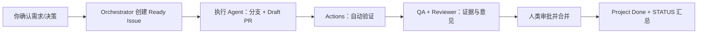

# AI 多 Agent 网站开发包：从零开始使用

这套文件把 AI 协作设计成一个可审计的小型开发团队：**人决定目标和高风险变更；GitHub 保存真实状态；Agent 在明确职责和验收标准下交付可审查的 PR。**

它不依赖某个单一 Agent 产品。Codex、Claude Code、OpenHands 或人工开发者只要能读取仓库文件、操作 GitHub Issue/PR，就能遵循同一套规则。

## 0. 先理解边界

这不是让多个 Agent “自动把网站做完”的魔法按钮。最常见的失败点是需求没确认、多个 Agent 改同一处、或把聊天内容误当项目状态。因此本包有三条底线：

1. **GitHub Issues / Project / PR / Actions 是事实源。** 聊天、日报和 `STATUS.md` 都只是引用事实源的说明。
2. **每个 Issue 只有一个直接负责角色。** 多 Agent 可以并行，但只并行做接口已稳定、文件不冲突的任务。
3. **人类审批是设计的一部分。** AI 不应自行决定需求、架构、隐私、安全、支付、生产部署或合并受保护分支。

## 1. 放进现有或新仓库

将本包的内容复制到你的网站仓库根目录，保留原有代码和配置。合并后至少应有：

```text
your-web-repo/
├── AGENTS.md                         # 所有 Agent 的总规则
├── PROJECT.md                        # 项目目标与责任人
├── REQUIREMENTS.md                   # 可追踪需求
├── ARCHITECTURE.md / API.md / DATABASE.md
├── ROADMAP.md / STATUS.md / RISKS.md / DECISIONS.md / TEST_PLAN.md
├── .agents/
│   ├── agents/                       # 角色说明
│   └── skills/                       # 可执行工作流程
├── .github/
│   ├── ISSUE_TEMPLATE/
│   ├── PULL_REQUEST_TEMPLATE.md
│   └── workflows/agent-governance.yml
└── tasks/example-task.yaml           # 任务数据交换示例（非第二事实源）
```

然后把项目初始信息填入 `PROJECT.md`：目标用户、这次发布要达成的结果、明确不做什么、负责人和仓库/Project 链接。接着把已知需求写入 `REQUIREMENTS.md`。不知道的地方不要硬填：放进 Open Questions，指定由谁决定、必须在哪个里程碑前决定。

首次提交建议命名为 `chore: add agent delivery operating system`，并通过 PR 让负责人确认这套治理规则。

## 2. 配置 GitHub：让它成为唯一的“项目看板”

### 2.1 建立标签

在仓库 Issues 中建立（或映射到已有）标签：

- `type:feature`、`type:bug`、`type:chore`
- `status:backlog`、`status:ready`、`status:blocked`
- `role:frontend`、`role:backend`、`role:database`、`role:qa`、`role:reviewer`
- `priority:p0`、`priority:p1`、`priority:p2`
- `risk:high`、`needs:human-decision`

标签方便筛选，但 **Project 自定义字段** 才是交付状态的权威表达。

### 2.2 新建 GitHub Project（表格 + 看板 + 路线图）

在 GitHub 的 Projects 中创建一个项目，选择 **Table** 起步。添加以下字段：

| 字段 | 类型 | 推荐值 |
|---|---|---|
| Status | Single select | Backlog, Ready, In progress, In review, Blocked, Done |
| Owner | Assignee 或 Text | 当前直接负责人 |
| Role | Single select | orchestrator, architect, frontend, backend, database, qa, reviewer |
| Priority | Single select | P0, P1, P2 |
| Milestone | Iteration/Text | M0–M3 或你的版本名 |
| Estimate | Single select | S, M, L |
| Risk | Single select | Low, Medium, High |
| Approval | Single select | Not needed, Pending human, Approved, Waived |
| PR | Text | PR 链接（也可使用 GitHub 自动关联） |

建立三个视图：

1. **Delivery board（看板）**：按 Status 分组，用于每天看流动状态。
2. **Milestone table（表格）**：按 Milestone 分组，显示 Owner、Risk、Approval；用于周会。
3. **Roadmap（路线图）**：按 Milestone/日期展示，用于和利益相关人沟通。

把每个 Issue 添加到 Project。建议启用 GitHub Projects 的内置工作流：**Item added to project → Backlog** 和 **Pull request merged → Done**。如果你坚持“只有合并才算 Done”，不要启用“Issue closed → Done”，因为 Issue 可能被手动关闭却没有合并代码。`In progress` 与 `In review` 由负责 Agent 在实际开始工作、打开 Draft PR 时更新；等流程稳定后再用 GitHub Actions 自动化。自动化不能替代判断：被关闭但未合并或验证失败的工作不应计为 Done。

### 2.3 分支保护与 Actions

对 `main`（或发布分支）启用 GitHub Branch Protection / Ruleset：要求 PR、至少一位审批者、状态检查通过、解决所有 review conversation，禁止直接推送。启用 `.github/workflows/agent-governance.yml` 后，每个 PR 还必须在正文写 `Closes #123`；这保证 Issue、PR 和项目状态可回溯。

这个示例 workflow 只检查关联关系，**不替代**你项目自己的 lint、类型检查、单测、构建、E2E、安全扫描 Actions。把这些真实的 CI 工作流按技术栈添加进来，并将它们设为 required checks。

## 3. 启动一个真实需求

按以下次序操作；不要一上来让 Agent 写代码。

1. 你在 GitHub 新建一个需求 Issue，或直接把用户问题交给 orchestrator。
2. orchestrator 使用 `.agents/skills/requirement-analysis/SKILL.md` 和 `.agents/skills/product-spec/SKILL.md`，补充 `PROJECT.md` 和 `REQUIREMENTS.md`，将不确定项列出来。
3. 你确认需求。对有明显取舍的需求，在 Issue 或对应 PR 评论写下 “Approved”。
4. architect 使用 architecture skill 填充 `ARCHITECTURE.md`、`API.md`、`DATABASE.md`，把重大选择写进 `DECISIONS.md`。你批准重大架构/安全/数据选择。
5. orchestrator 使用 task-decomposition skill 创建小 Issue，补齐 owner、依赖、验收、测试和审批字段，加入 Project。满足 Definition of Ready 才置为 Ready。

一个好的 Issue 是“访客能用键盘完成邮箱订阅，并在失败时看到可读错误”；一个不好的 Issue 是“做订阅功能”。前者可以测试、审查和完成，后者不能。

## 4. 让不同 Agent 接不同 Issue

### 4.1 分派规则

orchestrator 检查 Ready 和依赖后，用 task-dispatch skill 下发任务。一个安全、简短的分派提示如下：

```text
请负责 GitHub Issue #123。先阅读 AGENTS.md、.agents/agents/frontend.md、
Issue 链接的 FR/NFR 与 API.md。只做 Issue 的 in-scope 内容；不要改动无关文件或
改变接口。使用 feat/123-signup-form 分支，先开 Draft PR，并在 PR 中写 Closes #123。
提交测试结果、截图、风险及交接给 QA。遇到需求或接口不清晰时，将 Project 标为
Blocked 并在 Issue 中提出具体问题；不要自行猜测。
```

根据 Issue 的 `Role` 选择相应的 Agent profile：

| Issue 类型 | Profile | 典型输出 |
|---|---|---|
| 需求/跨团队排程 | `orchestrator.md` | Issue 列表、依赖、STATUS 报告 |
| 架构/接口决策 | `architect.md` | ADR、模块图、API/数据契约 |
| 页面/交互/可访问性 | `frontend.md` | Draft PR、截图、前端测试 |
| API/业务规则/授权 | `backend.md` | Draft PR、接口测试 |
| 模型/迁移/查询 | `database.md` | migration、恢复计划、集成测试 |
| 验收/回归 | `qa.md` | PR 验收报告、缺陷 Issue |
| 合并前质量审查 | `reviewer.md` | 可操作 review findings |

同一时刻只让一个 Agent 拥有同一个 Issue。以下可以并行：已批准 API 合同后的前端和后端、彼此隔离的页面、与实现无重叠的测试计划。以下不该并行：两个 Agent 修改同一个数据迁移、接口合同尚未确定的前后端、多个 Agent 处理同一 Bug。

### 4.2 Codex 怎么用

Codex 会优先读取仓库根目录的 `AGENTS.md`。开始某个 Issue 时，在提示里提供 Issue 链接/编号和对应 profile 路径，例如：

```text
阅读 AGENTS.md 和 .agents/agents/backend.md，完成 GitHub Issue #124。
严格以该 Issue 的验收标准为界，更新必要的 API.md/DATABASE.md，并开 Draft PR。
不要合并或部署；在 PR 中汇报所有验证证据和阻塞项。
```

对于规划工作，改用：

```text
作为 orchestrator，阅读 AGENTS.md、PROJECT.md、REQUIREMENTS.md 与 GitHub Project。
使用 .agents/skills/task-decomposition/SKILL.md 为已批准的 FR-001 至 FR-004 创建
可执行 Issue。不要写功能代码。输出依赖图、每个 Issue 的 owner 和需要人类确认的问题。
```

### 4.3 Claude Code 怎么用

Claude Code 同样能从仓库根目录的 `AGENTS.md` 获取总规则。若你的配置只自动读取 `CLAUDE.md`，可以建立一个极小的 `CLAUDE.md`，内容写明 “Read and follow AGENTS.md first.”，不要复制两套规范。每次执行前把 Issue 编号、角色 profile 和禁止的操作写进提示；要求它通过 PR 而不是聊天交付。

### 4.4 OpenHands 怎么用

启动 OpenHands 时将仓库作为工作目录，并在首条任务里明确：先读取 `AGENTS.md`、角色 profile、Issue 和关联合同；分支/PR 必须链接 Issue；遇到审批门或不确定性时停在 Blocked 而不是猜测。若 OpenHands 的 GitHub 集成具有写权限，仍应由 GitHub ruleset 把合并和生产变更挡在人工审批之后。

## 5. 日常开发节奏



建议的固定节奏：

- **需求出现时：** 先澄清和批准，再拆 Issue。
- **每天/每次交接：** orchestrator 看 GitHub Project、未合并 PR、失败 Actions、Blocked Issues；更新 `STATUS.md`。
- **每周/每里程碑：** 看 Roadmap、风险表、未决问题和依赖；必要时调整优先级或范围，且记录人类决定。
- **每个 PR：** 自动检查 → QA → reviewer → 人类审批 → merge。通过 CI 不是产品验收，QA 通过也不是越过人类的合并授权。

## 6. 如何汇总进度给你看

让 orchestrator 使用 `.agents/skills/project-reporting/SKILL.md`，并发送下面格式；其中每一句关键状态都应能点回 GitHub：

```text
截至 2026-08-20 16:00 CST，M2 为 Amber。
完成：#120 已在 PR #142 合并，Actions 全绿。
审查中：#123 / PR #145，等待 QA 的键盘验证。
下一步：#124（依赖 #123 的 API 契约）与 #126（独立页面）。
阻塞：#125 需要你在周五前确认数据保留期；否则注册发布延后。
风险：R-003 从 Medium 升至 High，因为供应商尚未提供测试环境。
```

注意：不要只看 “完成百分比”。更可靠的是：里程碑关键路径是否有 Blocked 工作、PR 是否堆积、CI 是否失败、是否存在高风险或逾期的人类决策。`STATUS.md` 的红黄绿必须给出原因和链接。

## 7. 人工审批清单

你（或正式指定的负责人）在以下位置给出批准：

| 场景 | 审批位置 | 你应确认什么 |
|---|---|---|
| 需求 | Issue/需求 PR | 用户、范围、成功标准和非目标 |
| 架构/数据/安全 | ADR PR / Issue 评论 | 选项、成本、可逆性、隐私和风险 |
| 单个功能 | PR review | 验收证据、测试、风险、是否符合预期 |
| 发布 | release PR/Issue | CI、回滚、监控、残余风险、上线窗口 |

批准可以很短，例如：`Approved for M2. 接受方案 A；保留期为 30 天。` 但不要仅在私聊中批准，因为之后无法审计。若必须临时放行某项未满足的 Definition of Done，请在 PR 中记录豁免内容、风险、补偿措施、过期日期和批准人。

## 8. 首次落地检查表

- [ ] 填写 `PROJECT.md`，并由负责人确认目标/范围。
- [ ] 把需求转成 `REQUIREMENTS.md` 的 FR/NFR 和问题清单。
- [ ] 建 GitHub Project、字段、三种视图和标签。
- [ ] 配置分支保护，接入项目真实 CI，并设 required checks。
- [ ] 创建并批准第一份架构/API/数据合同和 ADR。
- [ ] 从 Issue 模板创建第一批小任务，给每项设 Role、Owner、依赖、验收和 Approval。
- [ ] 只派发 Ready 且无依赖阻塞的 Issue。
- [ ] 要求每个 Agent 先开 Draft PR，包含 `Closes #Issue` 与证据。
- [ ] QA、reviewer 和人类负责人完成各自的职责；合并后才标 Done。
- [ ] orchestrator 从 GitHub 生成第一份 `STATUS.md`。

## 9. 常见陷阱与修正

| 症状 | 原因 | 修正 |
|---|---|---|
| Agent 说“已完成”，但看板没有变化 | 聊天代替事实源 | 要求 Issue、PR、Actions 链接；未合并不算完成 |
| 前端等待后端、后端等前端 | API 契约缺失 | architect 先批准 `API.md`，再并行 |
| PR 很大、无法审查 | Issue 不够小或范围漂移 | 拆成可独立验收的垂直切片 |
| Agent 自行做产品决定 | 需求/审批门不清晰 | 写入 Open Questions 和 Approval 字段，Blocked 等人决定 |
| 看板全绿但版本不好用 | 只测代码，不验收用户旅程 | QA 以验收标准和关键 E2E 旅程给证据 |

## 10. 可选增强（等基础流程稳定后）

当团队已能稳定使用 Issue → PR → Actions → Review → Merge 流程后，再考虑自动化：GitHub Project 自动化、CI 自动发布预览环境、依赖/安全扫描、Actions 生成进度统计。不要先引入复杂的多 Agent 编排框架；它们会增加新的状态、凭证和排障成本。现有的 GitHub 工作流已经足够让一名负责人管理多个 Agent 的协作。

## 官方参考（以 GitHub 当前文档为准）

- [GitHub Projects：表格、看板、路线图、字段与视图](https://docs.github.com/en/issues/planning-and-tracking-with-projects)
- [GitHub Projects 内置自动化](https://docs.github.com/en/issues/planning-and-tracking-with-projects/automating-your-project/using-the-built-in-automations)
- [受保护分支与合并前审批/状态检查](https://docs.github.com/en/repositories/configuring-branches-and-merges-in-your-repository/managing-protected-branches/managing-a-branch-protection-rule)
- [GitHub 状态检查](https://docs.github.com/en/pull-requests/reference/status-checks)
